  
  
  

  
  
  
  
  

<h2 align="center">▓▒░ PLAYER 1 ░▒▓</h2>

| STAT | VALUE |
|:--|:--|
| 🎮 Player | Mo'men Refaey |
| ⚔️ Class | Full-Stack Developer |
| 🧠 Subclass | AI Systems Builder |
| 🎓 Guild | Software Engineering Student |
| 🌍 Region | Egypt |
| 🗺️ Quest | OctoFin — AI multi-agent enterprise accounting |
| 🧰 Skills | MEAN · Next.js · .NET · Python · Go |
| 🤝 Co-op | Open-source collaboration (VOID IDE welcome) |
| 📫 Contact | moamen.refaey@hotmail.com |
| ⚡ Perk | "A good laugh can debug any code... eventually." |

### 📜 QUEST LOG

- 🔭 Currently building **[OctoFin](https://github.com/Moamen-R/OctoFin)**, an intelligent multi-agent system for end-to-end enterprise accounting.
- 🌱 Leveling up in **Software Engineering** and advanced **multi-agent AI** concepts.
- 👯 Open to co-op on innovative open-source projects, especially **[VOID IDE](https://github.com/voideditor/void#readme)**.
- 💬 Ask me about the **MEAN Stack**, **AI development**, or anything tech.
- ⚡ Fun fact: I believe a good laugh can debug any code... eventually.

  

<h2 align="center">▓▒░ CURRENT QUEST ░▒▓</h2>

  

> **OctoFin** is a multi-agent financial workflow system that automates corporate bookkeeping with 100% mathematical accuracy. It combines Vision AI for document comprehension with a deterministic Python engine for calculations. The system extracts data from unstructured invoices and receipts, reconciles bank and digital wallet transactions, maps entries to the Chart of Accounts, and posts validated double-entry journals directly into ERP systems. Confidence-based routing and human-in-the-loop approval guardrails catch anomalies and keep full financial control.

  

| Module | What it does |
|:--|:--|
| 👁️ **Vision AI Extraction** | Reads unstructured invoices and receipts |
| 🧮 **Deterministic Python Engine** | Runs every calculation for 100% mathematical accuracy |
| 🔁 **Reconciliation Agent** | Matches bank and digital wallet transactions |
| 📒 **CoA Mapping + ERP Posting** | Posts validated double-entry journals into the ERP |
| 🚦 **Confidence Routing** | Sends anomalies to human-in-the-loop approval |
| 📈 **Real-Time Insights** | Live visibility into the company's financials |

<h2 align="center">▓▒░ INVENTORY ░▒▓</h2>

  <h3>⚔️ FRONTEND</h3>
  
  <h3>🛡️ BACKEND</h3>
  
  <h3>💎 DATABASES + BAAS</h3>
  
  <h3>🧰 TOOLS + DEVOPS</h3>
  
    
  

<h2 align="center">▓▒░ HIGH SCORES ░▒▓</h2>

  
  
    
  
    
  
  <h3>🐍 BOSS FIGHT: CONTRIBUTION SNAKE</h3>
  
    
  
   
  

