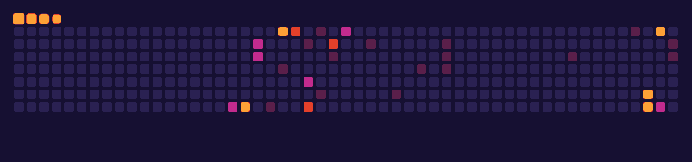

  
  
  

  
  
  
  
  

<h2>▓▒░ PLAYER 1 ░▒▓</h2>

<h3>📜 QUEST LOG</h3>

- 🔭 Currently building **[OctoFin](https://github.com/Moamen-R/OctoFin)**, an intelligent multi-agent system for end-to-end enterprise accounting.
- 🌱 Leveling up in **Software Engineering** and advanced **multi-agent AI** concepts.
- 👯 Open to co-op on innovative open-source projects, especially **[VOID IDE](https://github.com/voideditor/void#readme)**.
- 💬 Ask me about the **MEAN Stack**, **AI development**, or anything tech.
- ⚡ Fun fact: I believe a good laugh can debug any code... eventually.

<h2>▓▒░ CURRENT QUEST: OCTOFIN ░▒▓</h2>

**OctoFin** is an intelligent multi-agent system that automates end-to-end enterprise accounting, from invoice extraction and payment reconciliation to ERP journal posting and real-time financial insights.

It is designed to automate corporate bookkeeping with 100% mathematical accuracy. Vision AI handles document comprehension, and a deterministic Python engine handles every calculation. The system extracts data from unstructured invoices and receipts, reconciles bank and digital wallet transactions, maps entries to the Chart of Accounts, and posts validated double-entry journals directly into ERP systems. Confidence-based routing and human-in-the-loop approval guardrails keep anomalies under full financial control.

<h2>▓▒░ INVENTORY ░▒▓</h2>

<h4>FRONTEND</h4>

<h4>BACKEND</h4>

<h4>DATABASES &amp; BAAS</h4>

<h4>TOOLS &amp; DEVOPS</h4>

<h2>▓▒░ HIGH SCORES ░▒▓</h2>

<h2>🐍 BOSS FIGHT: CONTRIBUTION SNAKE</h2>

