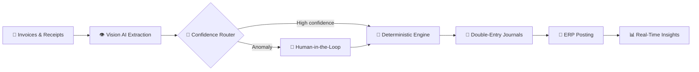

<!-- ═══════════════════ ANIMATED HEADER ═══════════════════ -->


<div align="center">
  <a href="https://git.io/typing-svg">
    
  </a>
</div>

<!-- ═══════════════════ CONNECT ═══════════════════ -->
<div align="center">
  <a href="https://www.linkedin.com/in/mo-men-refaey-545617374" target="_blank">
    
  </a>
  <a href="https://twitter.com/moarefaey" target="_blank">
    
  </a>
  <a href="https://dev.to/moamen.refaey" target="_blank">
    
  </a>
  <a href="https://www.leetcode.com/moarefaey" target="_blank">
    
  </a>
  <a href="mailto:moamen.refaey@hotmail.com">
    
  </a>
</div>

<div align="center">
  
  <a href="https://github.com/Moamen-R?tab=followers">
    
  </a>
</div>

## 🚀 About Me

> *Full-Stack Developer & Software Engineering student from Egypt 🇪🇬 — engineering the bridge between intelligent AI agents and rock-solid financial systems.*

- 🔭 Currently building **[OctoFin](https://github.com/Moamen-R/OctoFin)** — a multi-agent AI system automating enterprise accounting end-to-end
- 🌱 Deepening my knowledge in **Software Engineering**, **multi-agent architectures** & advanced **AI** concepts
- 👯 Open to collaborating on innovative open-source projects, especially **[VOID IDE](https://github.com/voideditor/void#readme)**
- 💬 Ask me about the **MEAN/MERN Stack**, **AI development**, or **fintech automation**
- 📫 Reach me at **moamen.refaey@hotmail.com**
- ⚡ Fun fact: I believe a good laugh can debug any code… eventually 😄

<details>
<summary>👨‍💻 <b>View my profile as code</b></summary>
<br/>

```ts
const momen: Developer = {
  name: "Mo'men Refaey",
  location: "Egypt 🇪🇬",
  roles: ["Full-Stack Developer", "Software Engineering Student"],
  currentMission: "OctoFin — autonomous enterprise accounting 🐙",
  stack: {
    frontend: ["Angular", "React", "Next.js", "TypeScript"],
    backend: ["Node.js", ".NET", "Python", "Go"],
    ai: ["Multi-Agent Systems", "Vision AI", "AI Automation"],
  },
  philosophy: "Deterministic math + intelligent agents = automation you can trust",
  funFact: "A good laugh can debug any code... eventually 😄",
};
```

</details>

## 🐙 Featured Project — OctoFin

> **AI Enterprise Automation Accountant** — an intelligent multi-agent system that automates end-to-end enterprise accounting: from invoice extraction and payment reconciliation to ERP journal posting and real-time financial insights.

OctoFin combines **Vision AI** for document comprehension with a **deterministic Python engine** for calculations — guaranteeing **100% mathematical accuracy**. It extracts data from unstructured invoices & receipts, reconciles bank and digital-wallet transactions, maps entries to the Chart of Accounts, and posts validated double-entry journals directly into ERP systems, with **confidence-based routing** and **human-in-the-loop guardrails** for anomalies.

### 🔄 The Autonomous Pipeline



### 🧩 Core Capabilities

<table>
  <tr>
    <td width="50%"><b>👁️ Vision AI Extraction</b><br/>Reads unstructured invoices & receipts with document-level comprehension.</td>
    <td width="50%"><b>🎯 Deterministic Accuracy</b><br/>A Python calculation engine guarantees 100% mathematical precision.</td>
  </tr>
  <tr>
    <td><b>🔄 Smart Reconciliation</b><br/>Automatically matches bank & digital-wallet transactions.</td>
    <td><b>📒 Chart of Accounts Mapping</b><br/>Intelligent account classification for every entry.</td>
  </tr>
  <tr>
    <td><b>🧾 ERP Journal Posting</b><br/>Validated double-entry journals pushed straight into your ERP.</td>
    <td><b>🛡️ Approval Guardrails</b><br/>Confidence-based routing with human-in-the-loop control.</td>
  </tr>
</table>

<div align="center">
  
  
  
  
  
  <br/><br/>
  <a href="https://github.com/Moamen-R/OctoFin">
    
  </a>
</div>

## 🛠️ Tech Arsenal

<table>
  <tr>
    <td align="center" width="190"><b>🎨 Frontend</b></td>
    <td></td>
  </tr>
  <tr>
    <td align="center"><b>⚙️ Backend</b></td>
    <td></td>
  </tr>
  <tr>
    <td align="center"><b>🗄️ Databases & BaaS</b></td>
    <td></td>
  </tr>
  <tr>
    <td align="center"><b>🛠️ DevOps & Tools</b></td>
    <td></td>
  </tr>
</table>

## 📊 GitHub Analytics

<div align="center">
  
  
</div>

<div align="center">
  
</div>

<div align="center">
  
</div>

<details>
<summary>🏆 <b>Trophy Cabinet</b></summary>
<br/>
<div align="center">
  
</div>
</details>

---

<div align="center">
  
  <br/><br/>
  <b>⭐️ From <a href="https://github.com/Moamen-R">Moamen-R</a> — let's build something intelligent together.</b>
</div>

<!-- ═══════════════════ ANIMATED FOOTER ═══════════════════ -->

