<!-- ═══════════════════════ HEADER ═══════════════════════ -->
<div align="center">


<a href="https://git.io/typing-svg">
  
</a>

<br/>


<br/><br/>

<a href="https://www.linkedin.com/in/mo-men-refaey-545617374" target="_blank"></a>
<a href="https://twitter.com/moarefaey" target="_blank"></a>
<a href="https://dev.to/moamen.refaey" target="_blank"></a>
<a href="https://www.leetcode.com/moarefaey" target="_blank"></a>
<a href="mailto:moamen.refaey@hotmail.com"></a>

</div>

<br/>

<!-- ═══════════════════════ ABOUT ═══════════════════════ -->
<h2 align="center">⚡ &lt;/About Me&gt;</h2>

<div align="center">
  
</div>

<br/>

```ts
const moamen = {
  role: "Full-Stack Developer & Software Engineering Student",
  location: "Egypt 🇪🇬",
  currentlyBuilding: "OctoFin — Multi-Agent AI Accounting System",
  currentlyLearning: ["Multi-Agent Architectures", "Vision AI", "System Design"],
  strongSuits: ["MEAN Stack", "Next.js", "AI-assisted development"],
  openTo: ["Open-source collaboration", "VOID IDE", "Innovative AI projects"],
  funFact: "A good laugh can debug any code... eventually. 😄",
  reachMe: "moamen.refaey@hotmail.com",
} as const;
```

<!-- ═══════════════════════ FEATURED PROJECT ═══════════════════════ -->
<h2 align="center">🐙 Currently Building: OctoFin</h2>

<div align="center">


<br/><br/>

<a href="https://github.com/Moamen-R/OctoFin">
  
</a>

</div>

> **An intelligent multi-agent system that automates end-to-end enterprise accounting** — from invoice extraction and payment reconciliation to ERP journal posting and real-time financial insights.

OctoFin combines **Vision AI** for document comprehension with a **deterministic Python engine** for calculations, so every figure is mathematically exact. It extracts data from unstructured invoices and receipts, reconciles bank and digital-wallet transactions, maps entries to the Chart of Accounts, and posts validated **double-entry journals** directly into ERP systems. For complete financial control, **confidence-based routing** and **human-in-the-loop approval guardrails** escalate anomalies for review.

### 🔄 How It Works

```mermaid
flowchart LR
    A["📄 Invoices & Receipts<br/>(unstructured)"] --> B["👁️ Vision AI<br/>Extraction Agent"]
    B --> C{"🎯 Confidence<br/>Router"}
    C -- "High" --> D["🧮 Deterministic<br/>Python Engine"]
    C -- "Low / Anomaly" --> H["🧑‍💼 Human Approval<br/>Guardrail"]
    H --> D
    E["🏦 Bank & Wallet<br/>Transactions"] --> F["🔗 Reconciliation<br/>Agent"]
    D --> F
    F --> G["📒 Chart of Accounts<br/>Mapping"]
    G --> J["✅ Double-Entry<br/>Journal Validation"]
    J --> K["🏢 ERP Posting"]
    K --> L["📊 Real-Time<br/>Financial Insights"]

    style A fill:#1e1b4b,stroke:#00BFFF,color:#fff
    style B fill:#1e1b4b,stroke:#A78BFA,color:#fff
    style C fill:#312e81,stroke:#FFA116,color:#fff
    style D fill:#1e1b4b,stroke:#00C853,color:#fff
    style H fill:#312e81,stroke:#FF5252,color:#fff
    style E fill:#1e1b4b,stroke:#00BFFF,color:#fff
    style F fill:#1e1b4b,stroke:#A78BFA,color:#fff
    style G fill:#1e1b4b,stroke:#A78BFA,color:#fff
    style J fill:#1e1b4b,stroke:#00C853,color:#fff
    style K fill:#1e1b4b,stroke:#00BFFF,color:#fff
    style L fill:#1e1b4b,stroke:#00C853,color:#fff
```



### ✨ Core Capabilities

| Capability | Description |
| :--- | :--- |
| 👁️ **Intelligent Extraction** | Vision AI reads unstructured invoices and receipts into structured data |
| 🧮 **Deterministic Math** | A Python engine performs all calculations, so no LLM arithmetic is involved |
| 🔗 **Smart Reconciliation** | Matches bank and digital-wallet transactions against documents |
| 📒 **Automated Classification** | Maps entries to the correct Chart of Accounts |
| 🏢 **ERP Integration** | Posts validated double-entry journals straight into ERP systems |
| 🛡️ **Financial Guardrails** | Confidence-based routing with human-in-the-loop approval for anomalies |
| 📊 **Live Insights** | Real-time financial visibility for decision makers |

<div align="center">
  <a href="https://github.com/Moamen-R/OctoFin"></a>
</div>

<br/>

<!-- ═══════════════════════ TECH STACK ═══════════════════════ -->
<h2 align="center">🛠️ Tech Arsenal</h2>

<div align="center">

<table>
  <tr>
    <td align="center" width="170"><b>🎨 Frontend</b></td>
    <td>
      
    </td>
  </tr>
  <tr>
    <td align="center"><b>⚙️ Backend</b></td>
    <td>
      
    </td>
  </tr>
  <tr>
    <td align="center"><b>🗄️ Databases & BaaS</b></td>
    <td>
      
    </td>
  </tr>
  <tr>
    <td align="center"><b>🚀 Tools & DevOps</b></td>
    <td>
      
    </td>
  </tr>
</table>

</div>

<br/>

<!-- ═══════════════════════ GITHUB STATS ═══════════════════════ -->
<h2 align="center">📊 GitHub Analytics</h2>

<div align="center">
  
  
</div>

<div align="center">
  
</div>

<div align="center">
  
</div>

<br/>

<!-- ═══════════════════════ COLLABORATE ═══════════════════════ -->
<h2 align="center">🤝 Let's Build Something Great</h2>

<div align="center">

| 🔭 Building | 🌱 Learning | 👯 Collaborating | 💬 Ask Me About |
| :---: | :---: | :---: | :---: |
| [OctoFin](https://github.com/Moamen-R/OctoFin) | Software Engineering & advanced AI | [VOID IDE](https://github.com/voideditor/void#readme) | MEAN Stack, AI development, anything tech |

<br/>

📫 <b>moamen.refaey@hotmail.com</b>

<sub>💡 "A good laugh can debug any code... eventually."</sub>

</div>

<!-- ═══════════════════════ FOOTER ═══════════════════════ -->

