<!--
  PALETTE
  Void      #05030F / #0A0618
  Indigo    #1A1038 / #221B45
  Cream     #EDEDF3
  Orange    #FDA136
  Ember     #E4402A
  Magenta   #C22B8E
-->

<!-- ═══════════════════════ HERO ═══════════════════════ -->

⬛⬛⬛⬜⬛⬛⬛⬛🟧🟧🟧🟧🟧⬛⬛⬛⬛⬛⬛⬛⬛ 
⬛⬜⬛⬛⬛⬛🟧🟧🟧🟧🟧🟧🟧🟧🟧⬛⬛⬛⬛⬛⬛ 
⬛⬛⬛⬛⬛🟥🟥🟧🟧🟧🟧🟧🟧🟧🟧🟧⬛⬛⬜⬛⬛ 
⬛⬛⬜⬛⬛🟥🟥🟥🟧🟧🟧🟧🟧🟧🟧🟧⬛⬛⬛⬛⬛ 
⬛⬛⬛⬛⬛🟥🟥🟥🟥🟧🟧🟧🟧🟧🟧🟧⬛⬛⬛⬛⬜ 
⬛⬜⬛⬛⬛🟪🟥🟥🟥🟥🟧🟧🟧🟧🟧🟧⬛⬛⬛⬛⬛ 
⬛⬛⬛⬛⬛🟪🟪🟥🟥🟥🟥🟧🟧🟧🟧🟧⬛🟪⬛⬛⬛ 
⬛⬛🟪⬛⬛⬛🟪🟪🟥🟥🟥🟥🟧🟧🟧⬛⬛⬛⬛⬛⬛ 
⬛⬛⬛⬛⬛⬛⬛⬛🟪🟪🟥🟥🟥⬛⬛⬛⬛⬜⬛⬛⬛ 

 

 

  

 

🟪🟪🟪🟪🟥🟥🟥🟥🟧🟧🟧🟧🟧🟧🟧🟧🟥🟥🟥🟥🟪🟪🟪🟪

 

<!-- ═══════════════════════ PLAYER 1 ═══════════════════════ -->
<h2 align="center">▓▒░ PLAYER 1 ░▒▓</h2>

 

| ▸ STAT | ▸ VALUE |
| :--- | :--- |
| 🎮 CLASS | Full-Stack Developer |
| 🎓 LEVEL | Software Engineering Student |
| 🌍 REGION | Egypt 🇪🇬 |
| ⚡ SPECIALTY | AI systems and multi-agent workflows |
| 🔭 MAIN QUEST | [OctoFin](https://github.com/Moamen-R/OctoFin) |
| 🌱 TRAINING | Software Engineering and advanced AI concepts |
| 👯 GUILD | Open to open-source collabs, especially [VOID IDE](https://github.com/voideditor/void#readme) |
| 💬 ASK ME ABOUT | MEAN Stack, AI development, anything tech |
| 😄 FUN FACT | A good laugh can debug any code... eventually |

 

<h3 align="center">▸ ATTRIBUTES</h3>

<!-- Illustrative levels: edit the squares to match your own self-assessment -->

| ATTRIBUTE | XP |
| :--- | :--- |
| FRONTEND | 🟧🟧🟧🟧🟧🟧🟧🟧⬛⬛ |
| BACKEND | 🟧🟧🟧🟧🟧🟧🟧⬛⬛⬛ |
| AI / AGENTS | 🟥🟥🟥🟥🟥🟥🟥⬛⬛⬛ |
| DEVOPS | 🟪🟪🟪🟪🟪⬛⬛⬛⬛⬛ |
| CURIOSITY | 🟧🟧🟧🟧🟧🟧🟧🟧🟧🟧 |

 

🟪🟪🟪🟪🟥🟥🟥🟥🟧🟧🟧🟧🟧🟧🟧🟧🟥🟥🟥🟥🟪🟪🟪🟪

 

<!-- ═══════════════════════ CURRENT QUEST ═══════════════════════ -->
<h2 align="center">▓▒░ MAIN QUEST: OCTOFIN ░▒▓</h2>

⬛⬛⬛🟧🟧🟧🟧🟧⬛⬛⬛ 
⬛⬛🟧🟧🟧🟧🟧🟧🟧⬛⬛ 
⬛🟧⬜⬜🟧🟧🟧⬜⬜🟧⬛ 
⬛🟧⬜⬛🟧🟧🟧⬜⬛🟧⬛ 
⬛🟧🟧🟧🟧🟧🟧🟧🟧🟧⬛ 
⬛🟥🟥⬛🟥🟥🟥⬛🟥🟥⬛ 
🟥🟥⬛⬛🟪🟪🟪⬛⬛🟥🟥 
🟪⬛⬛⬛⬛🟪⬛⬛⬛⬛🟪 

 

  

 

> An intelligent multi-agent system that automates end-to-end enterprise accounting: from invoice extraction and payment reconciliation to ERP journal posting and real-time financial insights.

OctoFin is a multi-agent financial workflow system designed to automate corporate bookkeeping with 100% mathematical accuracy. By combining Vision AI for document comprehension with a deterministic Python engine for calculations, it automatically extracts data from unstructured invoices and receipts, reconciles bank and digital wallet transactions, maps entries to the Chart of Accounts, and posts validated double-entry journals directly into ERP systems. To keep complete financial control, it uses confidence-based routing and human-in-the-loop approval guardrails for anomalies.

```mermaid
%%{init: {'theme':'dark','themeVariables': {'primaryTextColor':'#EDEDF3','lineColor':'#FDA136','fontFamily':'monospace'}}}%%
flowchart LR
    A["📄 Invoices and Receipts<br/>unstructured"] --> B["👁️ Vision AI<br/>Extraction Agent"]
    B --> C{"🎯 Confidence<br/>Router"}
    C -- "High" --> D["🧮 Deterministic<br/>Python Engine"]
    C -- "Low or Anomaly" --> H["🧑‍💼 Human Approval<br/>Guardrail"]
    H --> D
    E["🏦 Bank and Wallet<br/>Transactions"] --> F["🔗 Reconciliation<br/>Agent"]
    D --> F
    F --> G["📒 Chart of Accounts<br/>Mapping"]
    G --> J["✅ Double-Entry<br/>Journal Validation"]
    J --> K["🏢 ERP Posting"]
    K --> L["📊 Real-Time<br/>Financial Insights"]

    style A fill:#0A0618,stroke:#FDA136,color:#EDEDF3
    style B fill:#0A0618,stroke:#FDA136,color:#EDEDF3
    style C fill:#221B45,stroke:#E4402A,color:#EDEDF3
    style D fill:#0A0618,stroke:#FDA136,color:#EDEDF3
    style H fill:#221B45,stroke:#C22B8E,color:#EDEDF3
    style E fill:#0A0618,stroke:#FDA136,color:#EDEDF3
    style F fill:#0A0618,stroke:#E4402A,color:#EDEDF3
    style G fill:#0A0618,stroke:#E4402A,color:#EDEDF3
    style J fill:#0A0618,stroke:#C22B8E,color:#EDEDF3
    style K fill:#0A0618,stroke:#C22B8E,color:#EDEDF3
    style L fill:#221B45,stroke:#FDA136,color:#EDEDF3
```

<h3 align="center">▸ LEVEL MAP: HOW IT WORKS</h3>

<h3 align="center">▸ QUEST OBJECTIVES</h3>

| OBJECTIVE | DESCRIPTION |
| :--- | :--- |
| 👁️ INTELLIGENT EXTRACTION | Vision AI reads unstructured invoices and receipts into structured data |
| 🧮 DETERMINISTIC MATH | A Python engine performs every calculation, so no LLM arithmetic is involved |
| 🔗 SMART RECONCILIATION | Matches bank and digital wallet transactions against documents |
| 📒 AUTO CLASSIFICATION | Maps entries to the correct Chart of Accounts |
| 🏢 ERP INTEGRATION | Posts validated double-entry journals straight into ERP systems |
| 🛡️ FINANCIAL GUARDRAILS | Confidence-based routing with human approval for anomalies |
| 📊 LIVE INSIGHTS | Real-time financial visibility for decision makers |

 

 

🟪🟪🟪🟪🟥🟥🟥🟥🟧🟧🟧🟧🟧🟧🟧🟧🟥🟥🟥🟥🟪🟪🟪🟪

 

<!-- ═══════════════════════ INVENTORY ═══════════════════════ -->
<h2 align="center">▓▒░ INVENTORY ░▒▓</h2>

<h3 align="center">▸ FRONTEND</h3>

<h3 align="center">▸ BACKEND</h3>

<h3 align="center">▸ DATABASES AND BAAS</h3>

<h3 align="center">▸ TOOLS AND DEVOPS</h3>

 

🟪🟪🟪🟪🟥🟥🟥🟥🟧🟧🟧🟧🟧🟧🟧🟧🟥🟥🟥🟥🟪🟪🟪🟪

 

<!-- ═══════════════════════ SCOREBOARD ═══════════════════════ -->
<h2 align="center">▓▒░ HIGH SCORES ░▒▓</h2>

 

 

 

🟪🟪🟪🟪🟥🟥🟥🟥🟧🟧🟧🟧🟧🟧🟧🟧🟥🟥🟥🟥🟪🟪🟪🟪

 

<!-- ═══════════════════════ CONTACT ═══════════════════════ -->
<h2 align="center">▓▒░ PRESS START ░▒▓</h2>

 

| 🔭 BUILDING | 🌱 LEARNING | 👯 COLLABORATING | 💬 ASK ME ABOUT |
| :---: | :---: | :---: | :---: |
| [OctoFin](https://github.com/Moamen-R/OctoFin) | Software Engineering and advanced AI | [VOID IDE](https://github.com/voideditor/void#readme) | MEAN Stack, AI development, anything tech |

 

📫 moamen.refaey@hotmail.com

 

⬛⬛⬛🟥🟥⬛🟥🟥⬛⬛⬛ 
⬛⬛🟥🟧🟧🟥🟧🟧🟥⬛⬛ 
⬛⬛🟥🟧🟧🟧🟧🟧🟥⬛⬛ 
⬛⬛⬛🟥🟧🟧🟧🟥⬛⬛⬛ 
⬛⬛⬛⬛🟥🟧🟥⬛⬛⬛⬛ 
⬛⬛⬛⬛⬛🟥⬛⬛⬛⬛⬛ 

 

GAME OVER? NEVER. A good laugh can debug any code... eventually.

  

🟪🟪🟪🟪🟥🟥🟥🟥🟧🟧🟧🟧🟧🟧🟧🟧🟥🟥🟥🟥🟪🟪🟪🟪

