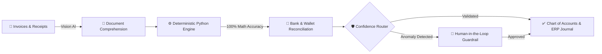

<div align="center">

  <!-- Animated Hero Banner -->
  

  <!-- Animated Typing Tagline -->
  <a href="https://github.com/Moamen-R">
    
  </a>

  <br/><br/>

  <!-- Social & Connect Badges -->
  <p>
    <a href="https://www.linkedin.com/in/mo-men-refaey-545617374" target="_blank">
      
    </a>
    <a href="https://twitter.com/moarefaey" target="_blank">
      
    </a>
    <a href="https://dev.to/moamen.refaey" target="_blank">
      
    </a>
    <a href="https://www.leetcode.com/moarefaey" target="_blank">
      
    </a>
    <a href="mailto:moamen.refaey@hotmail.com">
      
    </a>
    <a href="https://github.com/Moamen-R">
      
    </a>
  </p>

</div>

<br/>

---

###  About Me

> I'm a passionate **Full-Stack Developer** and **Software Engineering** student from Egypt with a deep focus on **Artificial Intelligence**, **Multi-Agent Workflows**, and scalable enterprise architecture.

<table>
<tr>
<td width="52%" valign="top">

- 🔭 **Current Focus:** Architecting **[OctoFin](https://github.com/Moamen-R/OctoFin)** — an intelligent multi-agent system automating end-to-end enterprise accounting.
- 🌱 **Exploring:** Advanced **Software Engineering** patterns, **Agentic AI Systems**, and **Vision-Language Models**.
- 👯 **Collaboration:** Open to innovative open-source projects, especially **[VOID IDE](https://github.com/voideditor/void#readme)**.
- 💬 **Ask Me About:** The **MEAN / MERN Stack**, **AI Engineering**, **Python Automation**, or full-stack architecture.
- 📫 **Direct Reach:** **[moamen.refaey@hotmail.com](mailto:moamen.refaey@hotmail.com)**
- ⚡ **Fun Fact:** *I believe a good laugh can debug any code... eventually.*

</td>
<td width="48%" valign="top">

```python
class SoftwareEngineer:
    def __init__(self):
        self.name = "Mo'men Refaey"
        self.location = "Egypt 🇪🇬"
        self.role = "Full-Stack & AI Systems Engineer"
        self.current_build = "OctoFin (Multi-Agent AI)"
        self.core_focus = [
            "Autonomous Multi-Agent Workflows",
            "Scalable Full-Stack Web Apps",
            "Deterministic Financial Engines"
        ]

    def motto(self) -> str:
        return "Precision in logic. Creativity in design."
```

</td>
</tr>
</table>

<br/>

---

<div align="center">
  <h2>🌟 Flagship Spotlight — OctoFin</h2>
  <p><i>Intelligent Multi-Agent Enterprise Accounting & Financial Workflow Automation</i></p>
</div>

<table>
<tr>
<td>

### 🐙 [OctoFin](https://github.com/Moamen-R/OctoFin) — AI Enterprise Automation Accountant

<p>
  
  
  
  
  
</p>

**OctoFin** is an intelligent multi-agent system that automates end-to-end enterprise accounting—from invoice extraction and payment reconciliation to ERP journal posting and real-time financial insights.

Designed as an **AI Enterprise Automation Accountant**, this multi-agent financial workflow system automates corporate bookkeeping with **100% mathematical accuracy**. By combining **Vision AI** for document comprehension with a **deterministic Python engine** for calculations, the system automatically:

- 📄 **Extracts** structured financial data from unstructured invoices and receipts.
- 🏦 **Reconciles** bank statements and digital wallet transactions seamlessly.
- 🗂️ **Maps & Posts** entries to the Chart of Accounts and dispatches validated double-entry journals directly into ERP systems.
- 🛡️ **Governs Risk** via confidence-based routing and **Human-in-the-Loop (HITL)** approval guardrails for anomalies to ensure complete financial control.

</td>
</tr>
</table>



<br/>

---

<div align="center">
  <h2>🛠️ Tech Arsenal & Engineering Stack</h2>
  <p><i>Technologies, frameworks, and infrastructure I use to bring ideas to production</i></p>
</div>

<table align="center">
  <tr>
    <td align="center" width="50%">
      <h3>🎨 Frontend Architecture</h3>
      <br/>
      <a href="https://skillicons.dev">
        
      </a>
      <br/><br/>
      <sub><code>Angular</code> • <code>React</code> • <code>Next.js</code> • <code>TypeScript</code> • <code>Redux</code> • <code>Tailwind</code></sub>
      <br/><br/>
    </td>
    <td align="center" width="50%">
      <h3>⚙️ Backend & AI Engines</h3>
      <br/>
      <a href="https://skillicons.dev">
        
      </a>
      <br/><br/>
      <sub><code>Python</code> • <code>Node.js</code> • <code>Express</code> • <code>.NET</code> • <code>Go</code> • <code>GraphQL</code></sub>
      <br/><br/>
    </td>
  </tr>
  <tr>
    <td align="center" width="50%">
      <h3>🗄️ Databases & BaaS</h3>
      <br/>
      <a href="https://skillicons.dev">
        
      </a>
      <br/><br/>
      <sub><code>MongoDB</code> • <code>MySQL</code> • <code>SQLite</code> • <code>Firebase</code> • <code>Appwrite</code></sub>
      <br/><br/>
    </td>
    <td align="center" width="50%">
      <h3>🚀 DevOps, Cloud & Tooling</h3>
      <br/>
      <a href="https://skillicons.dev">
        
      </a>
      <br/><br/>
      <sub><code>Docker</code> • <code>Kubernetes</code> • <code>Linux</code> • <code>Git</code> • <code>Jest</code> • <code>Figma</code></sub>
      <br/><br/>
    </td>
  </tr>
</table>

<br/>

---

<div align="center">
  <h2>📊 GitHub Analytics & Engineering Velocity</h2>

  <br/>

  <!-- Stats & Streak Side by Side -->
  
  

  <br/><br/>

  <!-- Top Languages -->
  

  <br/><br/>

  <!-- Contribution Graph -->
  

</div>

<br/>

<!-- Animated Footer -->
<div align="center">
  
</div>
